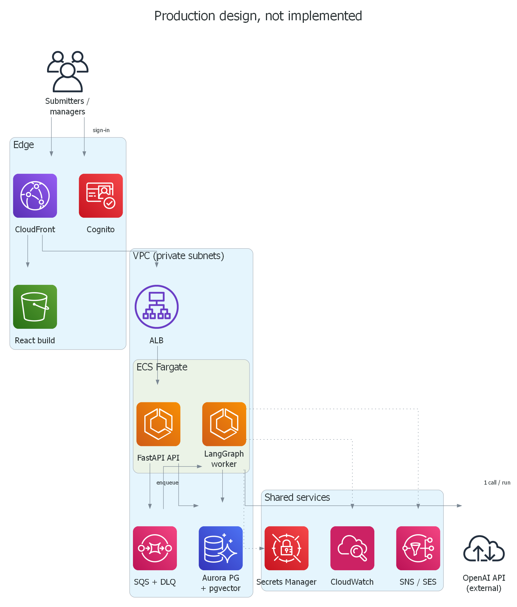
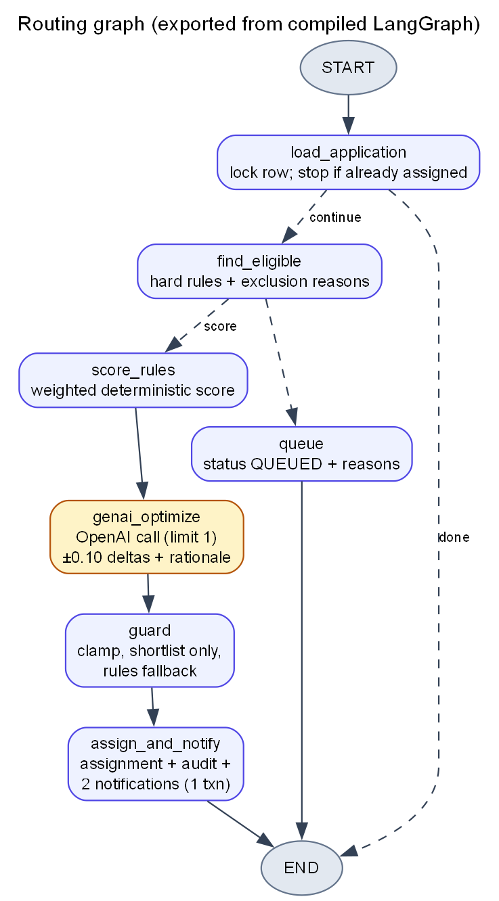
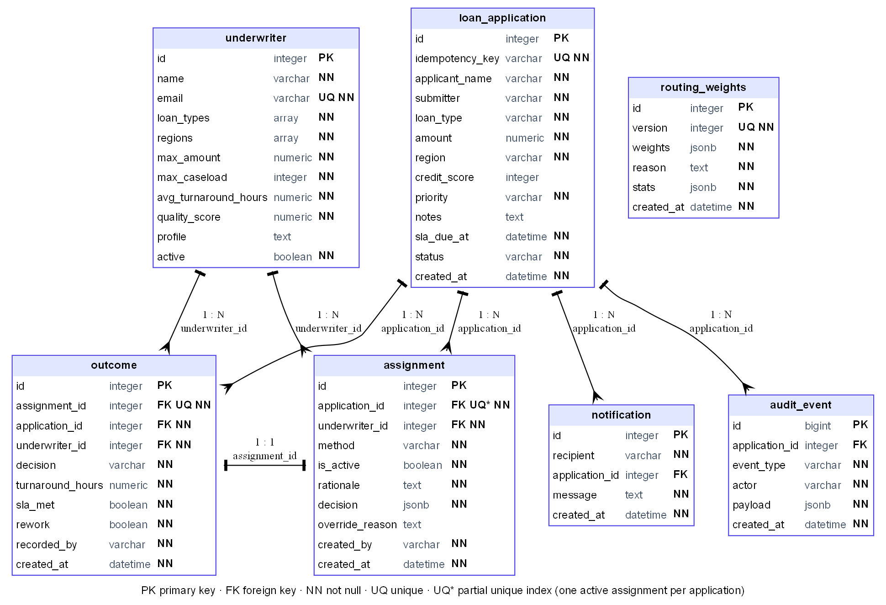

# UC24.1 — GenAI-Powered Loan Underwriter Assignment

Build report · local prototype (not deployed) · FastAPI + LangGraph + OpenAI + PostgreSQL + React/TypeScript

## 1. Summary

The app routes each new loan application to an underwriter and explains why. A rules engine filters and scores underwriters deterministically. One OpenAI call (`gpt-4o-mini`) may shift each of the top-3 scores by at most ±0.10 and writes the rationale, and code validates that output before anything is saved.
**Working today, locally only:** submission with duplicate protection, routing with live step and tool status, queueing when nobody is eligible, manager override with a required reason, outcome capture that **adapts routing** (per-underwriter stats plus versioned scoring weights), an audit trail, a dashboard, and an "ask why" agent. All of it has been exercised against a real local PostgreSQL 18 database and the live OpenAI API.
**Not built:** authentication, deployment (the AWS diagram is a design only), and embeddings/pgvector. Learning is heuristic (moving averages plus rate-based re-weighting), not a trained model.

## 2. Assumptions and out of scope

**Assumptions:** single machine; local Postgres (an Aurora cluster was provided, but its endpoint did not resolve in DNS); 9 seeded underwriters, 1 of them on leave; 4 loan types and 4 regions; "notify" means a row in the `notification` table; no login, so names are typed by hand.
**Out of scope / not built:** authentication and roles, email or SMS delivery, document upload, a message queue (routing runs in an in-process thread), Alembic migrations (tables come from `create_all`, plus one idempotent `ALTER` at startup), Docker/CI/deployment, embeddings/pgvector, Elasticsearch/Milvus, and ML-trained routing.

## 3. Functional requirements

| ID | Requirement | Status | Evidence in the code |
|---|---|---|---|
| FR1 | Submit a loan application | **Done** | `POST /api/applications`, validated by Pydantic |
| FR2 | Find eligible underwriters and record exclusion reasons | **Done** | `rules.eligibility_reasons`: active, loan type, region, amount, caseload |
| FR3 | Deterministic scoring and ranking | **Done** | `rules.score` (weights 0.3/0.3/0.2/0.2); ties broken by underwriter id |
| FR4 | GenAI refines the top 3 for fairness, SLA and fit, and writes a rationale | **Done** | `genai_optimize` and `guard`; skipped when only one candidate is eligible |
| FR5 | Assign the underwriter, notify, and show the rationale to the submitter | **Done** | Notifications are database rows only; nothing is emailed |
| FR6 | Queue when nobody is eligible; re-route on request | **Done** | `queue` node; manual `POST /…/route`; every completed case also re-routes all QUEUED applications |
| FR7 | Override with a required reason | **Done** | Reason of at least 10 characters, enforced by Pydantic and a database CHECK constraint |
| FR8 | Append-only audit trail | **Partial** | Events are written on every step, but nothing in the database prevents an UPDATE or DELETE |
| FR9 | Natural-language questions about a decision | **Done** | Tool-calling agent in `ask.py` with per-tool limits |
| FR10 | Dashboard of caseloads and recent assignments | **Done** | `GET /api/dashboard` and the Dashboard page |
| FR11 | Adaptive optimisation from outcomes | **Done** | `POST /…/complete` stores an `outcome`; `learning.py` updates the underwriter's quality and turnaround (EMA, α = 0.2) and, after at least 3 outcomes, writes a new `routing_weights` version that `score_rules` uses next |
| FR12 | Ask about learning ("why did the weights change?") | **Done** | `get_learning` tool (limit 1) in the ask agent |

## 4. Non-functional requirements

| ID | Target | How it is met (and gaps) |
|---|---|---|
| NFR1 | No duplicate routings | Unique `idempotency_key`; partial unique index (one active assignment per application); `SELECT … FOR UPDATE`; the graph exits early if the application is already assigned. A live duplicate POST returned the same application id. |
| NFR2 | No missed routings | The application is committed *before* routing starts, and its status is visible (NEW, ROUTED or QUEUED). QUEUED applications are re-routed whenever a case completes, and on startup every NEW or QUEUED application is re-routed (recovery after a crash; verified live). **Gap:** no recovery until the process restarts. |
| NFR3 | Every routing is auditable | `audit_event` stores the full decision JSON: candidates, scores, AI output, exclusions and model name. |
| NFR4 | Explainable and fair | A rationale, a per-factor score breakdown, exclusion reasons, a fairness factor, the weights version used, and override reasons. The prompt requires names, and `humanize_ids` replaces any leftover "Underwriter 2" with the name. |
| NFR5 | Deterministic | The rules ranking is pure and unit-tested. The OpenAI call uses `temperature=0` and `seed=42`, which makes it near-deterministic, though the API doesn't guarantee it. Its effect is bounded to ±0.10 and stored, so a decision can be audited without calling the LLM again. There is no replay endpoint. |
| NFR6 | Low latency: API under 500 ms; routing run under 10 s | Measured: API median **≈240 ms**; routing **3.4–4.1 s** with the LLM call. The OpenAI client has a 20 s timeout and 1 retry; on failure the rules winner is used. |
| NFR7 | Secrets kept out of code | Keys live only in `backend/.env`, which is git-ignored. The front-end reads only `VITE_API_BASE_URL`. |

## 5. Back-of-the-envelope estimate

| Quantity | Value | Basis |
|---|---|---|
| Requests per day | 2,000 applications × about 10 calls each (1 POST, about 4 polls, about 5 page loads) ≈ **20k requests/day**, about 0.25 req/s on average and about 2.5 req/s at a 10× peak | **Assumed** volume |
| Latency per routing run | 3.4 s and 4.1 s (2 runs with an LLM call); 0.01 s when only one candidate is eligible | **Measured**, local, n = 2+1 |
| Latency per "ask" run | 2.2 s, 1 tool call | **Measured**, n = 1 |
| Model cost per routing run | 615 input + 213 output tokens ≈ **$0.0002** per run, ≈ $0.44/day at 2,000 runs | Tokens **measured**; price **assumed** at gpt-4o-mini list rates ($0.15 / $0.60 per million tokens) |
| Storage | ≈ 4.5 KB per application across the routing tables (an outcome row adds about 0.1 KB, assumed) ≈ 9 MB/day ≈ 3.3 GB/year, before indexes | Decision JSON averages 1,424 B and audit payloads 865 B (**measured**); volume **assumed** |

## 6. System design

<figure class="aws">
<figcaption><b>AWS: production design, not implemented.</b> The API enqueues routing to SQS; a Fargate worker runs the same LangGraph against Aurora PostgreSQL with pgvector. Today, by contrast, a background thread runs routing inside the API process against local Postgres.</figcaption></figure>
<figure class="lg">
<figcaption><b>Routing graph, exported from the compiled LangGraph.</b> Dashed edges are conditional (already assigned → END; nobody eligible → queue). Only <code>genai_optimize</code> calls the LLM.</figcaption></figure>

<figure class="er">
<figcaption><b>Data model, generated from the SQLAlchemy models.</b> One application has many assignments, but the partial unique index allows only one active assignment, which blocks double routing. <code>outcome</code> and <code>routing_weights</code> hold the learning data.</figcaption></figure>

## 7. Key design choices

| Chose | Alternative | Reason |
|---|---|---|
| Rules engine ranks; the LLM adjusts only the top 3 by ±0.10 | Let the LLM choose freely | Keeps routing deterministic and safe: the LLM can never pick an ineligible underwriter |
| A `guard` node checks the LLM output | Trust the JSON as returned | It clamps adjustments, drops unknown ids, uses the LLM rationale only if the LLM's pick won, and falls back to the rules winner |
| **Tool-call limits per run:** graph state carries `run_id`; `genai_optimize` calls `runs.tool_call()` before OpenAI (limit 1); ask agent: `get_decision` 2, `get_underwriter` 3, `get_audit_trail` 2, `get_learning` 1, at most 4 turns | No limits | Caps cost and runaway loops. The counters live in the run registry (`runs.py`) keyed by `run_id`, not in `RouteState` itself |
| LangGraph `StateGraph` with 2 conditional edges | Plain function chain | Explicit nodes give live per-step status and readable branching |
| Background thread plus polling (30 attempts, 1 s apart) | Synchronous request, or SQS | Fits the time box; the UI shows progress and a timeout with a retry button |
| Uniqueness enforced by the database | An application-level check only | Safe even when two requests race |
| Learning: EMA per underwriter plus versioned, rate-based weights (minimum 3 outcomes) | Train an ML ranking model | Explainable and auditable (each version stores its reason); works with very little data |

## 8. Trade-offs

| Trade-off | Chose | What it costs | When I would switch |
|---|---|---|---|
| **In-process thread vs SQS + worker** | Thread | No retries, no backpressure, no dead-letter queue; a crash is recovered only at the next restart | Beyond about 5 req/s, or more than one API instance |
| **In-memory run registry vs Postgres/Redis** | In-memory | Progress is lost on restart; works only with a single process | As soon as there is more than one instance or a worker |
| **Polling vs WebSockets/SSE** | Polling (1 s, 30 attempts) | Up to 30 requests per run; about 1 s of delay in the UI | Many users watching runs at once |
| **LLM reads profiles vs embeddings (pgvector)** | LLM | Tokens on every run; less precise as history grows | When there are many past cases to search |
| **Local Postgres vs Aurora** | Local | No pgvector, not shared, not durable | When a working Aurora endpoint exists (the one provided does not resolve) |
| **Heuristic learning vs ML-trained ranker** | Heuristic | Coarse: only SLA-miss and rework rates move the weights | Once hundreds of labelled outcomes exist |
| **gpt-4o-mini vs a larger model** | gpt-4o-mini | Weaker judgement on subtle fit | If an evaluation set shows poor fit or poor rationales |

## 9. Testing and how to run

| Check | Command | Result |
|---|---|---|
| Backend unit tests (rules, guard, tool limit, learning maths, weights change ranking, name fix) | `cd backend; .venv\Scripts\python -m pytest tests -q` | **15 passed** in 1.5 s |
| Front-end type check / lint | `cd front-end; npm run typecheck; npm run lint` | **0 errors, 0 warnings** |
| Live checks (manual, against the API) | — | LLM routing (6 runs); single-candidate fallback; duplicate POST → same id; bad override → 422 + `request_id`; 3 outcomes → weights v1 (SLA 0.20→0.229, expertise 0.30→0.343) used by the next routing; completion re-routed a QUEUED app; double completion → 409 |

**Run:** first fill in `backend/.env` (DATABASE_URL, OPENAI_API_KEY), then `cd backend; .venv\Scripts\python -m uvicorn app.main:app --port 8000` and `cd front-end; npm run dev`, and open http://localhost:5173. There are no automated integration, end-to-end, front-end or load tests.

## 10. Known limitations and next steps

| Limitation | Risk | Mitigation |
|---|---|---|
| No authentication or roles | Anyone can override an assignment | Cognito/JWT with manager and submitter roles |
| Runs held in memory; recovery only at startup | A NEW application can wait until the next restart | Persistent runs table, SQS worker and a periodic sweep |
| Audit trail is append-only only by convention | History could be edited | Revoke UPDATE/DELETE on the table, or add a hash chain |
| Not deployed; tables created with `create_all` | Schema drift between environments | Alembic migrations plus infrastructure-as-code for the AWS design |
| Learning uses small samples and simple rules | Noisy weight swings | Larger window, minimum-change threshold (0.005 already applied), offline evaluation |

**P1:** authentication and roles; persistent runs with an SQS worker and a re-route sweep; Alembic migrations. **P2:** embeddings in pgvector (Aurora); an evaluation set for rationales and fit; a learning dashboard with charts. **P3:** AWS deployment as code; SES/SNS delivery for notifications; load testing.

## 11. API endpoints

Base URL `http://localhost:8000` (interactive docs at `/docs`). Errors return `{detail, request_id}`; 202 responses return a `run_id` to poll.

| Method | Path | Purpose | Request | Response |
|---|---|---|---|---|
| GET | `/api/health` | Liveness check | — | `{ok}` |
| POST | `/api/applications` | Submit an application and start routing (202) | applicant, submitter, loan_type, amount, region, credit_score, priority, notes, `idempotency_key` | `{application_id, run_id, duplicate, request_id}` |
| GET | `/api/runs/{run_id}` | Poll a routing or ask run | — | status, steps[], tools{calls, limit}, result, error |
| GET | `/api/applications` | List applications | `?status=` | applications with the assigned underwriter |
| GET | `/api/applications/{id}` | Application detail | — | application, assignment (scores, rationale, exclusions), outcome, history, audit, notifications |
| POST | `/api/applications/{id}/route` | Re-route a NEW or QUEUED application (202) | — | `{run_id}`; 409 if already routed |
| POST | `/api/applications/{id}/override` | Manager reassignment | underwriter_id, reason (≥ 10 chars), actor | new assignment and eligibility warnings |
| POST | `/api/applications/{id}/ask` | Ask about the decision (202) | question | `{run_id}`; the answer arrives in the run result |
| POST | `/api/applications/{id}/complete` | Record the outcome and learn from it | decision, turnaround_hours, rework, actor | outcome, learning (stats before/after, weights version), re-routed queued apps |
| GET | `/api/learning` | Adaptive learning state | — | current weights and version, outcome stats, history |
| GET | `/api/underwriters` | Underwriters with live load | — | load, capacity, quality, turnaround, completed |
| GET | `/api/dashboard` | Dashboard data | — | caseloads, counts by status, recent assignments, learning |
| GET | `/api/notifications` | Notifications | `?recipient=` | latest 50 notifications |
